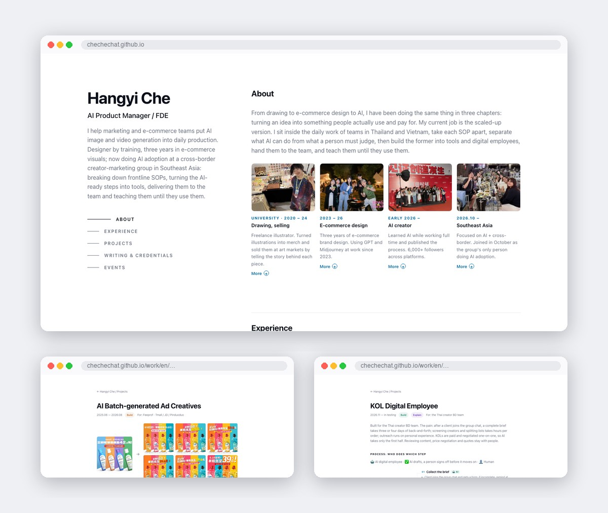

# Hangyi Che

**AI Product Manager / Forward Deployed Engineer** · Bangkok & Ho Chi Minh City

I help marketing and e-commerce teams put AI image and video generation into daily production. Designer by training, three years in e-commerce visuals; now doing AI adoption at a cross-border creator-marketing group in Southeast Asia: breaking down frontline SOPs, turning the AI-ready steps into tools, and teaching the team until they use them.

**Portfolio → [chechechat.github.io](https://chechechat.github.io/)** · [Resume](https://chechechat.github.io/resume-en.html) · [LinkedIn](https://www.linkedin.com/in/hangyi-che-a94bb6419/) · chehangyiii@gmail.com

## Selected work

Each page shows the before/after, which steps go to AI and which stay with a person, and real screenshots where I can share them.

| Project | What it does | Status |
|---|---|---|
| [Cross-border UGC short-video workflow](https://chechechat.github.io/work/en/ugc-video-workflow.html) | 6 agents: product image in, UGC short video out | Public template |
| [Product 3D Studio](https://chechechat.github.io/work/en/product3d-studio.html) · [repo](https://github.com/ChecheChat/product3d-studio) | One product photo → 3D, multi-angle shots, turntable video, AR | Open source |
| [AI batch promo images](https://chechechat.github.io/work/en/feibiqing-ab-creatives.html) | One reference → many variants, selected by paid testing | Delivered |
| [Short-video content workbench](https://chechechat.github.io/work/en/short-video-workbench.html) | Product breakdown · viral-video analysis · script generation | In testing · Vietnam |
| [Travel trend assistant](https://chechechat.github.io/work/en/trend-assistant.html) | Daily trend search · viral breakdown · push + self-learning | In use · Thailand |
| [KOL digital employee](https://chechechat.github.io/work/en/kol-workflow.html) | Reads briefs from group chats, shortlists creators, splits lists | In testing · Thailand |
| [Creator CRM](https://chechechat.github.io/work/en/creator-crm-bee.html) | 35 scattered sheets → one creator database | In use · Thailand |
| [E-commerce Wireframe Strategist](https://github.com/ChecheChat/ecommerce-wireframe-strategist) | Agent Skill: market and competitor material → wireframe strategy | Open source · Alibaba Cloud Model Studio certified |
| [Video Progress Bar Skill](https://github.com/ChecheChat/video-progress-bar-skill) | Chapters and timings → transparent progress-bar overlay for CapCut | Open source |

## Stack

Claude Code · GitHub · Lark digital employees · Midjourney · ComfyUI · GPT Image · Jimeng · Photoshop

中文版网站 → [chechechat.github.io/zh.html](https://chechechat.github.io/zh.html)
